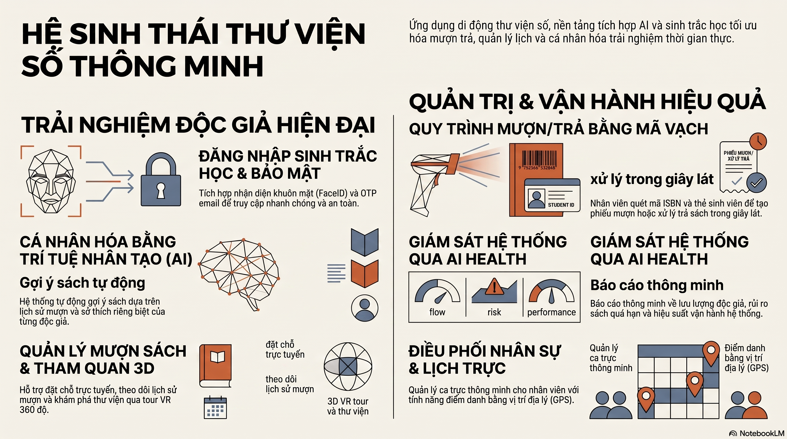

# Thư Viện Số Thông Minh — Mobile App

App di động cho hệ thống thư viện thông minh — mượn/trả sách, đăng nhập khuôn mặt, AI chatbot, thông báo realtime, quản lý thẻ bạn đọc.



## Architecture

```
Frontend_mobile/
├── src/
│   ├── api/                      # API client modules
│   │   ├── client.ts             # Axios instance + JWT interceptor + refresh token
│   │   ├── auth.ts               # Login, register, face-login
│   │   ├── borrow.ts             # Mượn/trả, waitlist, danh mục
│   │   ├── notification.ts       # Thông báo + WebSocket
│   │   ├── schedule.ts           # Lịch làm việc
│   │   ├── ai.ts                 # AI chatbot API
│   │   ├── googlebooks.ts        # Google Books API
│   │   ├── openlibrary.ts        # Open Library API
│   │   ├── accessRealtime.ts     # Realtime access logs (SSE)
│   │   └── secureStorage.ts      # SecureStore wrapper
│   ├── components/               # Reusable UI components
│   │   ├── ai/                   # AI-related components
│   │   ├── shared/               # Shared ui components
│   │   ├── AutoFaceCapture.tsx   # Tự động chụp khuôn mặt
│   │   ├── CameraFallback.tsx    # Fallback khi không có camera
│   │   ├── UndoBar.tsx           # Undo action bar
│   │   ├── SwipeReserveRow.tsx   # Vuốt đặt sách / báo khi có sách
│   │   ├── SwipeDeleteRow.tsx    # Vuốt xóa
│   │   ├── SearchField.tsx       # Ô tìm kiếm
│   │   ├── NoticeSnackbar.tsx    # Thông báo snackbar
│   │   ├── LoadingOverlay.tsx    # Loading overlay
│   │   ├── OfflineIndicator.tsx  # Chỉ thị offline
│   │   ├── ReauthModal.tsx       # Xác thực lại khi token hết hạn
│   │   ├── StudentCardScanner.tsx# Quét thẻ sinh viên
│   │   ├── CodeInput.tsx         # OTP code input
│   │   └── AssignmentCard.tsx    # Card phân ca
│   ├── context/                  # React Context providers
│   │   ├── AuthContext.tsx       # Auth state + refresh token
│   │   ├── ThemeContext.tsx       # Dark/light theme switcher
│   │   ├── NetworkContext.tsx     # Online/offline detection
│   │   └── NotificationContext.tsx# Realtime notifications
│   ├── features/                 # Feature modules (screens)
│   │   ├── home/                 # Trang chủ — dashboard, stats, camera
│   │   ├── auth/                 # Login, register, face-login, forgot password
│   │   ├── book/                 # Danh mục sách, gợi ý
│   │   ├── borrow/               # Mượn sách (staff), trả sách
│   │   ├── history/              # Lịch sử mượn/trả
│   │   ├── face/                 # Camera nhận diện khuôn mặt
│   │   ├── ai/                   # AI chatbot, health check
│   │   ├── library/              # Tour thư viện, waitlist
│   │   ├── notifications/        # Danh sách thông báo, chi tiết
│   │   ├── profile/              # Hồ sơ, đổi mật khẩu, chỉnh sửa
│   │   ├── schedule/             # Lịch làm việc
│   │   └── import/               # Import sách từ CSV/API
│   ├── navigation/               # React Navigation
│   │   ├── AppNavigator.tsx      # Stack + Bottom Tab navigator
│   │   ├── roleGuard.ts          # Role-based route gating
│   │   └── types.ts              # Navigation param types
│   ├── theme/                    # Design system
│   │   ├── MobileDesignSystem.tsx # Theme provider, token system
│   │   ├── colors.ts             # Color tokens
│   │   ├── BaseColors.ts         # Base palette
│   │   ├── DarkTheme.ts          # Dark theme
│   │   ├── LightTheme.ts         # Light theme
│   │   └── types.ts              # Theme types
│   ├── types/                    # TypeScript interfaces
│   ├── config/                   # App configuration
│   ├── i18n/                     # i18n (Vietnamese / English)
│   ├── lib/                      # Utilities
│   └── utils/                    # Helper functions
├── assets/                       # Images, icons, fonts
├── e2e/                          # Maestro E2E tests
├── App.tsx                       # Root component với ErrorBoundary
├── app.json                      # Expo config
├── eas.json                      # EAS Build profiles
└── index.ts
```

## Screens

| Screen | Auth | Mô tả |
|--------|------|-------|
| Home | Yes | Dashboard tổng quan — thống kê, camera entry/exit |
| Login | No | Đăng nhập (email + password) |
| Register | No | Đăng ký tài khoản bạn đọc |
| FaceLogin | No | Đăng nhập bằng khuôn mặt |
| ForgotPassword | No | Quên mật khẩu |
| BookCatalog | Yes | Danh mục sách — tìm kiếm, filter |
| BookRecommendations | Yes | Gợi ý sách |
| StaffBorrow | Staff | Mượn sách (nhân viên — quét barcode) |
| Return | Staff | Trả sách (quét barcode) |
| History | Yes | Lịch sử mượn/trả |
| MyReservations | Yes | Sách đang chờ (waitlist) |
| AIChat | Yes | AI chatbot hỗ trợ thư viện |
| AIHealth | Yes | Health check hệ thống |
| LibraryTour | No | Tour thư viện 3D |
| Profile | Yes | Hồ sơ — thẻ bạn đọc, membership |
| EditProfile | Yes | Chỉnh sửa hồ sơ |
| ChangePassword | Yes | Đổi mật khẩu |
| Notifications | Yes | Danh sách thông báo |
| NotificationDetail | Yes | Chi tiết thông báo |
| FaceCamera | Yes | Camera đăng ký / xác thực khuôn mặt |
| Schedule | Staff | Lịch làm việc, ca, chấm công |
| ImportBooks | Staff | Import sách từ CSV |

## Tech Stack

- **Expo 56** (managed workflow)
- **React Native 0.85** + **React 19**
- **TypeScript** 6.0
- **React Navigation 7** (Stack + Bottom Tabs)
- **react-native-paper** 5 — Material Design 3 components
- **Axios** — HTTP client + JWT interceptor
- **Zustand** — state management
- **Expo Camera** — face recognition, barcode scanning
- **Expo SecureStore** — lưu token an toàn
- **react-native-ml-kit** — text recognition (quét thẻ sinh viên)
- **@react-native-async-storage** — persistent storage

## API Integration

Mobile app gọi trực tiếp backend API Gateway. Base URL cấu hình trong `.env`:

```env
API_URL=http://10.0.2.2:80/api  # Android emulator
# hoặc http://localhost:80/api   # iOS simulator
```

### Auth Flow

1. Đăng nhập → nhận `access_token` + `refresh_token`
2. Lưu token trong SecureStore
3. Axios interceptor tự động gắn `Authorization: Bearer <token>`
4. 401 → auto refresh token → retry
5. Refresh hết hạn → ReauthModal → đăng nhập lại

## Cài đặt

### Yêu cầu

- Node.js 20 LTS
- Expo CLI (`npm install -g expo-cli` hoặc `npx expo`)
- Backend đang chạy (xem `Backend/README.md`)

### Local dev

```bash
# 1. Cài dependencies
npm install

# 2. Tạo .env (xem .env.example)
copy .env.example .env

# 3. Start dev server
npx expo start
```

Quét QR code bằng Expo Go (Android/iOS) hoặc nhấn `a` cho Android emulator / `i` cho iOS simulator.

### Build

```bash
# Preview build (APK/IPA)
npx eas build --profile preview

# Production build
npx eas build --profile production
```

## Scripts

```bash
npm start         # Expo dev server
npm run android   # Build + run Android
npm run ios       # Build + run iOS
npm run web       # Chạy trên web
npm test          # Jest unit tests
```

## Tính năng chính

### Face Recognition
- Face camera — đăng ký khuôn mặt
- Face login — đăng nhập bằng khuôn mặt
- AutoFaceCapture — tự động phát hiện và chụp khuôn mặt

### Mượn/Trả sách
- Quét barcode sách
- Tìm kiếm danh mục (Google Books, Open Library)
- Gợi ý sách từ AI
- Waitlist — báo khi có sách

### AI Chatbot
- Hỏi đáp về thư viện (giờ mở cửa, chính sách, vị trí sách)
- RAG với ChromaDB knowledge base

### Realtime
- Thông báo push (quá hạn, có sách, gia hạn thẻ)
- WebSocket realtime cho trạng thái

### Quản lý
- Staff borrow — nhân viên quét sách cho bạn đọc
- Import sách từ CSV
- Lịch làm việc, chấm công
- Quét thẻ sinh viên (ML Kit text recognition)

## Environment

| Variable | Mô tả |
|----------|-------|
| `API_URL` | Backend API Gateway URL |
| `WS_URL` | WebSocket URL cho realtime |
| `GOOGLE_BOOKS_API_KEY` | API key Google Books |

## Troubleshooting

- **Network error**: Đảm bảo backend đang chạy, kiểm tra `API_URL` trong `.env`
- **Camera không hoạt động**: Cấp quyền camera trong settings
- **Token expired**: ReauthModal sẽ hiện — đăng nhập lại
- **Android emulator**: Dùng `10.0.2.2` thay vì `localhost`
